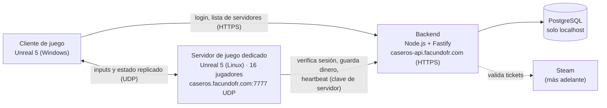

# Arquitectura técnica

Cómo está construido Barrio y por qué. Estado de cada parte: [PLAN.md](PLAN.md). Reglas del juego: [DISENO_JUEGO.md](DISENO_JUEGO.md).

## 1. Principio

**El servidor de juego decide todo lo que pasa en la partida. El backend decide todo lo que persiste. El cliente solo muestra y pide.**

El cliente nunca decide si un disparo acertó, cuánto dinero tiene ni qué rol tiene. Envía pedidos (moverse, disparar, interactuar) y el servidor valida y responde. El dinero solo se mueve a través del backend.

## 2. Componentes



El backend y el servidor de juego corren en el mismo VPS. El servidor de juego habla con el backend por `127.0.0.1`, sin salir a internet.

### Para quien viene del desarrollo web

Del mismo proyecto de Unreal salen tres programas distintos, y el backend va aparte:

| Pieza | Qué es | Dónde corre | Equivalente en web |
| --- | --- | --- | --- |
| Editor (`BarrioEditor`) | Donde se arma el juego: mapa, Blueprints, pruebas | La PC con Windows (necesita placa de video) | VS Code más `npm run dev` |
| Cliente (`Barrio.exe`) | El juego que se baja cada jugador: dibuja la imagen y manda teclado y mouse | La PC de cada jugador | El frontend, pero instalado en la PC del jugador en vez de servido por Nginx |
| Servidor dedicado (`BarrioServer`) | El juego sin gráficos: tiene la partida en memoria, decide todo y les manda el estado a los jugadores unas 30 veces por segundo | El VPS (Linux) | Un servidor de WebSockets con el estado en memoria, pero por UDP |
| Backend + PostgreSQL | Cuentas y dinero: lo que sobrevive a la desconexión | El VPS | Una API como cualquier otra |

Lo que cambia respecto de una app web:
- **El juego no pasa por Nginx.** Nginx solo atiende el HTTPS del backend. Los jugadores se conectan directo al puerto 7777/UDP del VPS, que tiene que estar abierto en `ufw` y en el firewall del panel de Hostinger.
- **Decide el servidor** (sección 1): el cliente solo pide. Así nadie hace trampa modificando su propio cliente.
- **El build se hace en la PC.** En Unreal se llama *empaquetar*: compila el código y *cocina* los assets para cada plataforma. Necesita una PC potente con Windows, y la carpeta que sale se sube al VPS con `scp`, como subir un `dist/` a mano ([ENTORNOS.md](ENTORNOS.md)).
- **El VPS no tiene el arte.** En su copia del repo, los `.uasset` son punteros de Git LFS de unos 130 bytes. El servidor empaquetado ya lleva adentro lo que usa.
- **Cliente y servidor van juntos:** mismo commit y mismo motor, o el servidor rechaza al jugador ("version mismatch", [DESPLIEGUE_VPS.md](DESPLIEGUE_VPS.md), 5.2).
- **Salas de 16, no un MMO.** Un mundo con miles de jugadores necesita tecnología de servidores propia, de estudio grande. Para tener más gente se abren más salas iguales (sección 6).

## 3. Stack

| Capa | Tecnología | Por qué | Estado |
| --- | --- | --- | --- |
| Juego (cliente y servidor) | Unreal Engine 5, C++ | El mismo código compila cliente y servidor dedicado. Trae replicación y movimiento predicho en red | En uso |
| Movimiento | Character Movement Component, con sprint propio predicho en red | Predicción y corrección del servidor incluidas | En uso |
| Combate | Componentes propios de vida y arma, con el daño simple del motor | Suficiente para una sola arma. GAS entra cuando haya armaduras y más armas | En uso |
| Interfaz | HUD dibujado con Canvas y login en Slate, sin assets | Permite probar sin arte. Se reemplaza por UMG | En uso |
| Backend | Node.js 24 + TypeScript + Fastify + zod | Experiencia web del programador | En uso |
| Base de datos | PostgreSQL (PGlite embebido para desarrollo y pruebas) | Transacciones para dinero sin duplicación | En uso |
| HTTPS | Caddy o Nginx con certbot, según lo que ya tenga el VPS | Convive con otros sitios del VPS | En uso |
| Mundo grande | World Partition | Carga por celdas | Cuando el mapa crezca |
| Vehículos | Chaos Vehicles | Integrado en el motor; riesgo alto en red | Etapa 7 |
| Login con Steam | Online Subsystem Steam y validación de tickets en el backend | La validación ya está escrita en el backend | Después del MVP |
| Monitoreo | Logs JSON (Fastify y journald) | Grafana y Loki si hace falta | Básico |

**Por qué Unreal y no Unity o Godot:** Unreal trae resuelto lo más difícil de este juego para una sola persona: movimiento en tercera persona con predicción en red, servidores dedicados y mundo abierto. Con Unity habría que construir la predicción y la compensación de latencia; Godot no tiene ese nivel en multijugador. Contras de Unreal: curva alta en C++ y servidores dedicados solo con el motor compilado desde el código fuente. Regalías: 5 % de los ingresos brutos por encima de 1 millón de USD por producto (verificar las condiciones vigentes en el sitio de Epic).

**Versión del motor:** la última 5.x estable al empezar a compilar, congelada durante el MVP.

## 4. Flujos principales

**Entrar a jugar:**
1. El cliente hace login con usuario y contraseña en el backend y recibe un token de sesión de 15 minutos.
2. Pide la lista de servidores y se conecta al recomendado, con el token en la URL (`caseros.facundofr.com:7777?token=...`).
3. El servidor de juego verifica el token con el backend **antes** de crear el personaje. Si falla, o si la cuenta ya está conectada, lo expulsa.

**Robar y vender:**
1. El cliente pide interactuar con una puerta (RPC).
2. El servidor valida rol, distancia y estado de la casa; arranca el robo y decide si suena la alarma.
3. La alarma se avisa solo a los policías cercanos.
4. Al vender al reducidor, el servidor de juego pide al backend un movimiento de dinero con una **clave de idempotencia**. Si la red falla, reintenta con la misma clave, sin riesgo de pagar dos veces.

**Qué valida siempre el servidor:** rol y permisos (quién puede dañar a quién), distancia de interacción, cadencia y munición, punto de vista y dirección de cada disparo, límite de frecuencia de los pedidos, y todo movimiento de dinero.

## 5. Persistencia

En la memoria del servidor de juego vive el estado de la partida: posiciones, rol, botín encima, casas y alarmas. Se pierde al reiniciar, a propósito. En PostgreSQL, a través del backend, vive lo que sobrevive a la desconexión.

| Tabla | Contenido |
| --- | --- |
| `accounts` | Cuenta: Steam (opcional), nombre, estado (activa o suspendida) |
| `credentials` | Usuario, email opcional, hash scrypt de la contraseña, intentos fallidos, bloqueo |
| `characters` | Un personaje por cuenta |
| `wallets` | Saldo del banco. La base impide que sea negativo |
| `ledger_entries` | Cada movimiento de dinero, con clave de idempotencia única y saldo resultante |
| `game_servers` | Instancias del servidor de juego, con su último heartbeat |
| `audit_log` | Altas de cuentas, movimientos de dinero, logins fallidos |

Migraciones SQL versionadas en `backend/migrations/`; se aplican solas al arrancar. API completa: [BACKEND.md](BACKEND.md).

## 6. Servidores de juego

- Cada instancia es el mismo barrio, siempre abierto, con 16 cupos. El personaje vive en el backend, así que se puede jugar en cualquier instancia.
- Al arrancar, la instancia se registra en el backend y manda un heartbeat cada 15 s. Si deja de mandarlo, sale de la lista.
- El backend recomienda la instancia con más gente que todavía tenga lugar, para concentrar jugadores.
**Escala, por fases.** El código del juego no cambia entre una fase y otra. Cómo llevar el servidor de juego a otro VPS: [DESPLIEGUE_VPS.md](DESPLIEGUE_VPS.md), sección 5.3.

| Fase | Dónde corre el servidor de juego | Cuándo pasar a la siguiente |
| --- | --- | --- |
| Desarrollo y prueba con amigos | El VPS del backend (Hostinger KVM 2, compartido con otras apps), prendido solo para probar | Si pasa de unos 2 GB de RAM, si hay tirones o si hay seguido más de una sala llena |
| Alpha | Un VPS chico solo para el juego, en São Paulo. El backend se queda donde está | Cuando haga falta abrir y cerrar salas según la cantidad de jugadores |
| Lanzamiento en Steam | Un orquestador, como Agones o Edgegap | — |

Consumo estimado de una sala de 16, que se mide en la etapa 5: entre 0,5 y 2 GB de RAM, cerca de un núcleo y pocos Mbps. Desde Buenos Aires hasta el VPS en Brasil hay unos 30 a 40 ms, suficiente para este juego.

## 7. Estructura del código de Unreal

Cada sistema es un módulo de C++. El compilador impide dependencias circulares.

| Módulo | Contenido | Depende de |
| --- | --- | --- |
| `BarrioCore` | PlayerState, PlayerController, eventos (`UBarrioGameEvents`), regla de daño, interfaz de interacción, tipos | Nada del juego |
| `BarrioCombat` | Vida y arma | Core |
| `BarrioCharacters` | Personaje, movimiento, controles, captura | Core, Combat |
| `BarrioWorld` | Barrio gris, puertas robables, reducidor, comisaría, salidas, zonas seguras, celda | Core |
| `BarrioOnline` | Login, sesión, dinero y registro del servidor contra el backend | Core |
| `BarrioUI` | HUD y pantalla de login | Core, Combat, Characters, Online |
| `Barrio` (principal) | GameMode: todas las reglas | Todos |

**Reglas:**
- Los sistemas no se llaman entre sí: informan eventos a `UBarrioGameEvents`, y el GameMode decide.
- Ningún módulo depende de `BarrioUI`.
- Las reglas del juego viven en el GameMode y siguen [DISENO_JUEGO.md](DISENO_JUEGO.md).

## 8. Estructura del repositorio

```
/game          Proyecto de Unreal (Barrio.uproject, Config, Source, Content)
/backend       API Node.js + TypeScript (src, migrations, test)
/infra/vps     Scripts y servicios para el VPS
/docs          Documentación (este archivo y los demás)
```

Control de versiones: Git con Git LFS y bloqueo de archivos para los assets binarios de Unreal (`.uasset`, `.umap`).

## 9. Seguridad

- Contraseñas con hash scrypt; límite de pedidos por IP y bloqueo de la cuenta tras 5 intentos fallidos.
- La clave de servidor solo la tienen el backend y el servidor de juego, por variables de entorno. Nunca va en el cliente ni en el repositorio.
- Sin anti-cheat de kernel: la defensa es la autoridad del servidor. Se reevalúa antes de un lanzamiento público.
- El backend y la base escuchan solo en `127.0.0.1`. Desde afuera solo se ven HTTPS (443) y el puerto UDP del juego (7777).
