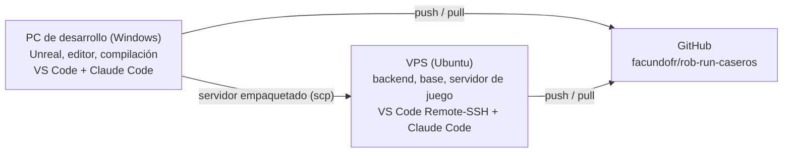

# Cómo trabajar: entornos

Barrio se trabaja desde **dos lugares**, sincronizados por GitHub. Este documento dice qué se hace en cada uno y cómo dejar el VPS listo para trabajar con VS Code y Claude Code. Qué se instala para que el juego corra en el VPS: [DESPLIEGUE_VPS.md](DESPLIEGUE_VPS.md).



## 1. Qué se hace en cada lugar

| Tarea | PC de desarrollo | VPS |
| --- | --- | --- |
| Código C++ de Unreal: escribir y **compilar** | ✓ | ✗ |
| Editor de Unreal: mapa, Blueprints, probar con varios jugadores | ✓ | ✗ |
| Empaquetar el servidor de juego para Linux | ✓ | ✗ |
| Backend: programar, `npm test` | ✓ | ✓ |
| Desplegar el backend, reiniciar servicios, ver logs | — | ✓ |
| Subir y arrancar el servidor de juego empaquetado | Lo sube con `scp` | Lo arranca |
| Documentación | ✓ | ✓ |

**Por qué Unreal no se trabaja en el VPS:** el editor necesita placa de video y pantalla. Compilar pide 16 a 32 GB de RAM, muchos núcleos y más de 150 GB de disco, y el KVM 2 tiene 2 vCPU, 8 GB y unos 100 GB, sin GPU. Además, una compilación de horas dejaría sin recursos a las apps React que ya corren en producción en ese VPS.

## 2. Flujos de trabajo

**Cambio en el juego (Unreal):**
1. En la PC: programar, compilar y probar en el editor ([PRUEBAS.md](PRUEBAS.md)).
2. Commit y push a `main`.
3. Si cambió algo del servidor: empaquetar `BarrioServer` para Linux y subirlo ([DESPLIEGUE_VPS.md](DESPLIEGUE_VPS.md), sección 5).

**Cambio en el backend:**
1. En la PC o en el VPS, en tu copia de trabajo: programar y correr `npm test`.
2. Commit y push a `main`.
3. En el VPS: `bash /opt/barrio/repo/infra/vps/deploy-backend.sh` (baja lo último de GitHub y reinicia).

**Algo falla en producción:**
1. Conectarse al VPS con VS Code.
2. Pedirle a Claude que revise los logs (`journalctl -u barrio-backend` o `-u barrio-server`) y el estado de los servicios.
3. El arreglo se hace en la copia de trabajo, se prueba, se sube a GitHub y se despliega. **Nunca se edita a mano `/opt/barrio/repo`**: es la copia de producción y solo la actualiza `deploy-backend.sh`.

**Dos copias del repo en el VPS:**

| Carpeta | Para qué | Quién la toca |
| --- | --- | --- |
| `~/rob-run-caseros` | Copia de trabajo: se edita, se prueba, se hace commit | Vos y Claude |
| `/opt/barrio/repo` | Copia de producción, de la que corre el backend | Solo `setup-vps.sh` y `deploy-backend.sh` |

## 3. Preparar el VPS para trabajar (una sola vez)

### 3.1 Un usuario propio con clave SSH

No se trabaja como root: con un usuario propio, un error no puede romper el sistema sin pedir `sudo` antes.

En el VPS, como root (por la consola web del panel de Hostinger o por SSH). Reemplazar `facu` por el usuario que quieras:

```bash
adduser facu
usermod -aG sudo facu
```

En la PC de desarrollo (PowerShell), crear una clave y copiarla al VPS:

```powershell
ssh-keygen -t ed25519
type $env:USERPROFILE\.ssh\id_ed25519.pub | ssh facu@IP_DEL_VPS "mkdir -p ~/.ssh && cat >> ~/.ssh/authorized_keys && chmod 700 ~/.ssh && chmod 600 ~/.ssh/authorized_keys"
```

Comprobar que `ssh facu@IP_DEL_VPS` entra **sin pedir contraseña**. Recién entonces, si querés, desactivar el login con contraseña (`PasswordAuthentication no` en `/etc/ssh/sshd_config` y `sudo systemctl reload ssh`). Si algo sale mal, la consola web del panel de Hostinger sigue funcionando.

Para no escribir la IP cada vez, agregar en la PC el archivo `C:\Users\<tu usuario>\.ssh\config`:

```
Host barrio-vps
    HostName IP_DEL_VPS
    User facu
    IdentityFile ~/.ssh/id_ed25519
```

Desde ahí alcanza con `ssh barrio-vps`.

### 3.2 Herramientas en el VPS

Conectado como tu usuario:

```bash
# Node.js del proyecto (lo instala setup-vps.sh) disponible en la terminal
echo 'export PATH=/opt/barrio/node/bin:$PATH' >> ~/.bashrc && source ~/.bashrc

# Git y GitHub CLI para hacer push
sudo apt install -y git gh
git config --global user.name "Tu nombre"
git config --global user.email "tu-email"
gh auth login            # elegir GitHub.com, HTTPS, y autenticar en el navegador

# Copia de trabajo
git clone https://github.com/facundofr/rob-run-caseros.git ~/rob-run-caseros
cd ~/rob-run-caseros/backend && npm install && npm test
```

Si `setup-vps.sh` todavía no se ejecutó, `/opt/barrio/node` no existe: primero seguir [DESPLIEGUE_VPS.md](DESPLIEGUE_VPS.md), secciones 1 a 3.

### 3.3 VS Code conectado al VPS

En la PC:
1. Instalar en VS Code la extensión **Remote - SSH** (de Microsoft).
2. `F1` → **Remote-SSH: Connect to Host...** → `barrio-vps`.
3. **File → Open Folder** → `/home/facu/rob-run-caseros`.

Todo lo que se abre en esa ventana (archivos, terminal) está en el VPS.

### 3.4 Claude Code en el VPS

Con VS Code conectado al VPS, abrir la vista de extensiones, buscar **Claude Code** y elegir **Install in SSH: barrio-vps**. También se puede usar desde la terminal del VPS: seguir las instrucciones de instalación para Linux de la documentación oficial de Claude Code. Iniciar sesión con la cuenta de Claude.

Al abrir la carpeta del repo, Claude Code lee `CLAUDE.md` y `AGENTS.md`, y sabe que está en el VPS y qué puede hacer ahí.

## 4. Precauciones en el VPS

El VPS tiene otros servicios en producción.

- **Dejar activa la confirmación de comandos** en Claude Code: revisar antes de aprobar cualquier `sudo`, `systemctl restart`, borrado o cambio de configuración de Nginx o Caddy.
- **No tocar** la configuración de las apps React ni el subdominio `api.facundofr.com`.
- **No compilar Unreal** ni correr tareas pesadas.
- **Secretos:** `/etc/barrio/*.env` no se copia al repo ni se pega en un chat.
- **Backup de la base** antes de cambios grandes: ver "Comandos útiles" en [DESPLIEGUE_VPS.md](DESPLIEGUE_VPS.md).

## 5. PC de desarrollo

Se trabaja con el repo clonado localmente, con VS Code o Visual Studio y Claude Code local. Preparación, compilación y editor: [GUIA_DESARROLLO.md](GUIA_DESARROLLO.md).
